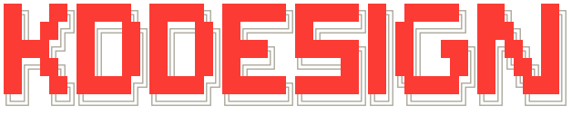

<h1 align="center"></h1>

<p align="center">KD's design skills for coding agents.</p>

Three skills turn what you ship into design rules your agents follow. `/crazy-prototype` explores, `/design-delta` records what actually shipped and why, and `/design-lessons` turns the lessons that keep coming back into rules, once you agree. The rules then feed back into every record that follows. Two more stand outside the loop. `/design-whip`: run it when an agent's design has gone sloppy, and it fixes the changes by nine fixed rules on the spot. `/break-it`: run it on a surface you just built, and it tries everything the craziest real person would, then hands what broke to `/crazy-prototype`.

<p align="center"></p>

<sub>Read it in terraces, high to low: pages for you on claude.ai, what Claude runs in this session, and the git repo, the only part kept for good. Read it left to right: explore, build, notice, record, distill. Dotted traces are what you paste back. Red traces are the rules half: five Deltas become a Design Lessons Review, your Verdicts decide what a review changes, and the rules come back to every build and every record.</sub>

## Install

KDDESIGN is one Claude Code plugin: the six skills and the Nudge ([ADR 0010](docs/adr/0010-kddesign-ships-as-one-plugin.md)).

**Claude Code plugin** (recommended). In Claude Code, add this repo as a marketplace and install from it:

```
/plugin marketplace add Jingquank/KDDESIGN
/plugin install kddesign@kddesign
```

The skills then run as `/kddesign:crazy-prototype`, `/kddesign:design-delta`, `/kddesign:design-lessons`, `/kddesign:design-whip`, `/kddesign:break-it` and `/kddesign:design-morph`, and the Nudge loads with them. To pick up a newer version later, run `/plugin marketplace update kddesign`.

**From a local clone.** Clone the repo and add the folder as the marketplace instead of the GitHub name:

```
git clone https://github.com/Jingquank/KDDESIGN.git
/plugin marketplace add ./KDDESIGN
/plugin install kddesign@kddesign
```

**For one session only.** While working on the plugin, `claude --plugin-dir .` in this folder loads it for that session without installing it.

**Skills only, without the Nudge.** Copy or symlink `skills/crazy-prototype`, `skills/design-delta`, `skills/design-lessons`, `skills/design-whip`, `skills/break-it` and `skills/design-morph` into `~/.claude/skills/`. The commands are then `/crazy-prototype`, `/design-delta`, `/design-lessons`, `/design-whip`, `/break-it` and `/design-morph`, and nothing asks you when it is time to record. Don't combine this with the plugin, or every skill shows up twice.

The skills live in `skills/<name>/`, the Nudge in `hooks/register.tsx`.

## The skills

| Skill | What it does |
|---|---|
| `/crazy-prototype <brief>` | Turns a brief into one Artifact page full of pickable Ideas. Tick the Ideas you mean and paste the Pick sheet back with what to do; the next Round applies it. |
| `/design-delta` | Lays this conversation's or this branch's design Changes out Before beside After on one Artifact page, the Design Changelog, and writes a text Delta of the decisions into the target project's `docs/deltas/`, or the folder a `Design deltas:` line in `AGENTS.md` or `CLAUDE.md` names. When git ignores that folder, as many shared repos ignore `docs/`, it asks once where Deltas should live ([ADR 0015](docs/adr/0015-deltas-folder-is-named-by-a-pointer-line.md)). The page is a fixed viewer fed by `delta.json`. |
| `/design-lessons` | Reads every Delta, counts the sources behind each rule candidate, and puts those with enough evidence on one Artifact page, the Design Lessons Review. The rules you accept go into the project's design rules. `/design-delta` runs it on its own once 5 Deltas have piled up since the last review. |
| `/design-whip [scope]` | Checks this conversation's UI changes (else this branch's, or the scope you name), Artifact pages included, against nine fixed rules: no labels nobody asked for, consistency, reuse, keep removing, no jargon, show don't tell, align the text, not the box. It fixes every violation on the spot and lists what changed by rule ([ADR 0013](docs/adr/0013-design-whip-fixes-by-eleven-fixed-rules.md)). |
| `/break-it [scope]` | Opens the surfaces this conversation (else this branch) built, or the one you name, in the running app and plays the craziest real person of the product against them: endless titles, 100 uploads, another language, double clicks, a dead network. Every write is held in the browser with a fake reply, so nothing reaches the backend or the repo, production included ([ADR 0016](docs/adr/0016-break-it-keeps-crazy-data-in-the-browser.md)). What broke lands on one Artifact page, the Break Report, each Break with a still, its steps and a Must. Tick the ones to fix and paste the Fix Brief to run `/crazy-prototype`. |
| `/design-morph [act] [link] [--mp4]` | Turns a redesign into a film on one Artifact page: each Act morphs an old page into the new one element by element, skeleton first (grid, layout, content, then skin), with design guide lines and a caption per Chapter. Sources are live URLs or two commits of one repo. It asks three things (the page pairs, the media, the overlays), and does not hand over until its checker finds no overlap, spill or leftover in any in-between frame ([ADR 0022](docs/adr/0022-design-morph-hands-over-only-with-no-open-finding.md)). The film lives only in the Artifact; name an Act to redo it at the same link, or ask for the MP4. |

## What you do

Everything else runs by itself. You answer the Nudge with one key, and you act in three places, each by pasting one text back into the conversation.

1. **On a prototype page.** Tick the Ideas you mean, copy the Pick sheet, paste it back with what to do (drop, merge, vary). The next Round applies it. Pick sheets stay in prototyping: they are quick calls among rough Ideas, so they never become rules.
2. **On a Design Changelog** (optional). Correct a Kind or write a Note, press Copy Notes, paste it back. The page turns static and its Delta is marked reviewed. One Note of yours is enough to put a rule candidate up for review.
3. **On a Design Lessons Review.** Give each item Accept, Reject or Watch, add a Note to reword it, press Copy Verdicts, paste it back. Only now does the review change the rules; no reply changes nothing. The rules stay yours too: edit them by hand, or ask any agent to, and the next review builds on what it finds.

## The Nudge

You do not have to remember to run `/design-delta` or `/design-lessons`. When a stretch of design work has Settled (you approved it, moved to another surface or to non-UI work, or began to ship), the Nudge asks above the prompt, the way a survey does:

```
█══╡ design-delta ╞═════════════════════════════════════════════
 Just finished: 3 checkout changes settled · pay button, coupon, summary
 Run design-delta in the background to record a Design Changelog?
 1: Do it   2: Why   3: Not now
```

**1** puts a one-line request into the conversation in your name, Claude starts the run in a background subagent, and the conversation carries on; the request is what lets auto mode see you asked ([ADR 0014](docs/adr/0014-nudge-asks-in-the-conversation.md)). While it runs, the rule becomes a red block bar with a sheen moving through it; it advances milestone by milestone (diff, stills, page, publish, Delta), read from the run's own tool calls, and the row under it types out the action being taken. A notification says when the Design Changelog is ready, and the band offers **Open** (the page, or both pages when the lessons ran too), **Approve** (asks in your name to make the Changelog Final as is and accept every Review item as drafted), **Approve with Changes** (puts a line in the prompt box to paste your Notes or Verdicts under) and **Dismiss**. On the offer, **2** explains why now and what it would cover. **3** leaves it until more work Settles. It stays off in a project until you have run `/design-delta` there by hand once, so projects without a UI are never asked. It never asks while UI work or a run of `/design-delta` or `/design-lessons` is under way, nor offers again what a run just recorded; while a survey or another mod holds the band it waits as one line in the status line and comes back when the band is free. It asks for `/design-lessons` once 5 Deltas have piled up since the last review, and `/nudge` asks right away. It speaks the language you write in and lays itself out for the terminal's width. A background run asks nothing: it records from the last Delta to a snapshot taken when you press 1, and takes its stills in an Ego lite tab of its own ([ADR 0011](docs/adr/0011-nudge-runs-design-delta-unattended.md)).

The Nudge is a Claude Code mod: it draws in the terminal and in the Desktop app's Code tab, not in the VS Code extension, `claude -p` or cloud sessions.

## One rule, all the way round

1. While building a checkout, you say “the pay button gets lost next to the coupon field”. `/design-delta` writes it into that Delta's Avoid, sourced to the conversation, and proposes `rule/primary-action-own-row`, Pending.
2. Weeks later, an onboarding commit says “Continue and Skip side by side; people pressed Skip by mistake”. Another Delta proposes the same id: now there are two sources.
3. That run writes the fifth Delta since the last review, so `/design-delta` runs `/design-lessons` at its hand-over. You get the Design Changelog and a Design Lessons Review together.
4. It counts sources as events, not lines: one conversation and one commit make 2, over the bar. The review shows the drafted rule, its sources, and the Before and After screenshots of the Change it came from.
5. You Accept with the Note “only in multi-step flows” and paste the Verdicts back. The rule is narrowed as the Note says and written into the design rules, which every coding agent reads through one line in `AGENTS.md`.
6. From then on `/design-delta` checks every Change against it. A Change that breaks it gets a `Breaks:` line; two breaks bring the rule back to a Design Lessons Review, where Accept keeps it and Reject removes it.

Vocabulary: [`CONTEXT.md`](CONTEXT.md). Decisions: [`docs/adr/`](docs/adr/).
