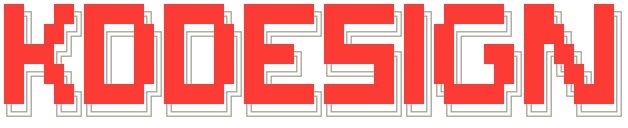

<h1 align="center"></h1>

<p align="center">KD's design skills for coding agents.</p>

Three skills turn what you ship into design rules your agents follow. `/crazy-prototype` explores, `/design-delta` records what actually shipped and why, and `/design-lessons` turns the lessons that keep coming back into rules, once you agree. The rules then feed back into every record that follows. Four more stand outside the loop. `/whip-it`: run it when an agent's design has gone sloppy, and it fixes the changes by nine fixed rules on the spot. `/break-it`: run it on a surface you just built, and it tries everything the craziest real person would, then hands what broke to `/crazy-prototype`. `/design-morph`: run it on a redesign, and it turns old pages into new ones as a film, element by element. `/iterate-it`: run it on a prototype, and it makes it more real with the project's own design system, components and media, or, told to lower it, more abstract as faux UI.

<p align="center"></p>

<sub>Follow the white marble: it is one design change. It leaves the hopper as a picked Idea, rolls the UI work run past the whip and the hammer, and waits on the trap door until you push. Under the Nudge it rolls through design-delta, which drops a Delta into the tube. The fifth Delta tips design-lessons, and a red marble, a rule, rides the lift back up to the build and to every later record. The dotted trace is a Fix Brief: what break-it knocked off the run goes back to the hopper.</sub>

## Install

KDDESIGN is one Claude Code plugin: the seven skills and the Nudge.

**Claude Code plugin** (recommended). In Claude Code, add this repo as a marketplace and install from it:

```
/plugin marketplace add Jingquank/KDDESIGN
/plugin install kddesign@kddesign
```

The skills then run as `/kddesign:crazy-prototype`, `/kddesign:design-delta`, `/kddesign:design-lessons`, `/kddesign:whip-it`, `/kddesign:break-it`, `/kddesign:design-morph` and `/kddesign:iterate-it`, and the Nudge loads with them. To pick up a newer version later, run `/plugin marketplace update kddesign`.

**From a local clone.** Clone the repo and add the folder as the marketplace instead of the GitHub name:

```
git clone https://github.com/Jingquank/KDDESIGN.git
/plugin marketplace add ./KDDESIGN
/plugin install kddesign@kddesign
```

**For one session only.** While working on the plugin, `claude --plugin-dir .` in this folder loads it for that session without installing it.

**Skills only, without the Nudge.** Copy or symlink `skills/crazy-prototype`, `skills/design-delta`, `skills/design-lessons`, `skills/whip-it`, `skills/break-it`, `skills/design-morph` and `skills/iterate-it` into `~/.claude/skills/`. The commands are then `/crazy-prototype`, `/design-delta`, `/design-lessons`, `/whip-it`, `/break-it`, `/design-morph` and `/iterate-it`, and nothing asks you when it is time to record. Don't combine this with the plugin, or every skill shows up twice.

The skills live in `skills/<name>/`, the Nudge in `hooks/register.tsx`.

## The skills

| Skill | What it does |
|---|---|
| `/crazy-prototype <brief>` | Turns a brief into one Artifact page full of pickable Ideas. Tick the Ideas you mean and paste the Pick sheet back with what to do; the next Round applies it. |
| `/design-delta` | Lays this conversation's or this branch's design Changes out Before beside After on one Artifact page, the Design Changelog, and writes a text Delta of the decisions into the target project's `docs/deltas/`, or the folder a `Design deltas:` line in `AGENTS.md` or `CLAUDE.md` names. When git ignores that folder, as many shared repos ignore `docs/`, it asks once where Deltas should live. Each still is taken only once the page is at rest, and a reviewer who sees only the stills and their descriptions must find every Change in them. The page is a fixed viewer fed by `delta.json`. |
| `/design-lessons` | Reads every Delta, counts the sources behind each rule candidate, and puts those with enough evidence on one Artifact page, the Design Lessons Review. The rules you accept go into the project's design rules. `/design-delta` runs it on its own once 5 Deltas have piled up since the last review. |
| `/whip-it [scope]` | Checks this conversation's UI changes (else this branch's, or the scope you name), Artifact pages included, against nine fixed rules: no labels nobody asked for, consistency and reuse, keep together what belongs together, animate only for context, keep removing, no jargon, as few words as possible, show don't tell, align the text, not the box. It fixes every violation on the spot and lists what changed by rule. |
| `/break-it [scope]` | Opens the surfaces this conversation (else this branch) built, or the one you name, in the running app and plays the craziest real person of the product against them: endless titles, 100 uploads, another language, double clicks, a dead network. Every write is held in the browser with a fake reply, so nothing reaches the backend or the repo, production included. What broke lands on one Artifact page, the Break Report, each Break with a still, its steps and a Must. Tick the ones to fix and paste the Fix Brief to run `/crazy-prototype`. |
| `/design-morph [act] [link] [--mp4]` | Turns a redesign into a film on one Artifact page: each Act morphs an old page into the new one element by element, skeleton first (grid, layout, content, then skin), with design guide lines and a caption per Chapter. Sources are live URLs or two commits of one repo. It asks three things (the page pairs, the media, the overlays), and does not hand over until its checker finds no overlap, spill, leftover, one-frame jump or drift in any in-between frame, no string clips in its own box, and a fresh-eye reviewer who sees only the frames returns nothing. The film lives only in the Artifact; name an Act to redo it at the same link, or ask for the MP4. |
| `/iterate-it [lower] [link \| path] [Ideas]` | Moves one prototype's Fidelity in one direction and redeploys it to the same link. By default it raises it: the repo's own token values, its components rebuilt from source, its icons, fonts and copy, believable data, every control's states, and the project's own media where it fits (else a product screenshot or a stock photo, never an SVG drawn to imitate one). Told to lower it ("lower", "more abstract", "faux ui"), it turns content into bars and blocks with 3 to 7 real strings on the focus, keeping the look, the information architecture and every interaction. On a `/crazy-prototype` page it changes only the Ideas you name or Pick. |

## What you do

Everything else runs by itself. You answer the Nudge with one key, and you act in two places, each by pasting one text back into the conversation. A Design Changelog is not one of them: nobody reviews it, and if a Kind or a Change on it is wrong you just say so.

1. **On a prototype page.** Tick the Ideas you mean, copy the Pick sheet, paste it back with what to do (drop, merge, vary). The next Round applies it. Pick sheets stay in prototyping: they are quick calls among rough Ideas, so they never become rules.
2. **On a Design Lessons Review.** Give each item Accept, Reject or Watch, add a Note to reword it, press Copy Verdicts, paste it back. Only now does the review change the rules; no reply changes nothing. A lesson you stated yourself as a general preference is enough to put a candidate up; anything else needs two sources. The rules stay yours too: edit them by hand, or ask any agent to, and the next review builds on what it finds.

## The Nudge

You do not have to remember to run `/design-delta` or `/design-lessons`. When you push UI work that no Delta has recorded yet, the Nudge asks once above the prompt, the way a survey does:

```
┌ feat/checkout 1f0d1e5‥9c2e4b1                                    █ █  ▄▀ █▀▀ ┐
  H O L D   Record what was pushed?                                ▀▀█ ▄▀  ▄▄█
  ███─███─███─██ Coupon Fix ██───────┼───────┼───────┼▲ now          to REVIEW
           Just pushed: 3 checkout changes ╰──────────────────────╯
  /checkout B● A●  /pricing B● A○                                       ◆ claim
└ 1: Do it   2: Why   3: Not now                                               ┘
```

It is a small heads-up display. The strip across the middle is your branch: the solid blocks are the Deltas already recorded since the last Design Lessons Review, the ticks are the commits you just pushed, and `▲ now` is where you are. Around it sit the readouts: the branch and range, a countdown to the next Review (4 of 5 Deltas), the pages it has a Before and an After of, and whether this session holds the claim on the push. The word in the middle is the state: `ARMED`, `REC`, `SAVED`, `HOLD` when it needs a key, `FAIL`. It lays itself out for the terminal's width: below 80 columns the big digits become `4/5`, below 56 it is three rows.


**1** puts a one-line request into the conversation in your name, Claude starts the run in a background subagent, and the conversation carries on; the request is what lets auto mode see you asked. The run records exactly what was pushed, takes its Before and After pictures from snapshots of your pages (below), and when it ends the Nudge commits the Delta file by itself. While it runs the display reads `REC`, a red block grows over the commits it is recording, the action being taken is typed out under it, and **1** folds it to one row in the status line (it then starts folded next time; `/nudge` opens it). When it is done the display closes by itself and one row says `SAVED` with the page's link. When a Design Lessons Review is ready the display reads `HOLD` with the count at 5/5 and offers **Open**, **Approve** (asks in your name to accept every Review item as drafted), **Approve with Changes** (puts a line in the prompt box to paste your Verdicts under) and **Dismiss**. On the offer, **2** explains what it would cover. **3** leaves it until the next push, which is then recorded together with this one. Work that is not pushed is never asked about. It stays off in a project until you have run `/design-delta` there by hand once, so projects without a UI are never asked. It never asks while a run of `/design-delta` or `/design-lessons` is under way, nor offers again what a run just recorded; while a survey or another mod holds the band it waits as one line in the status line and comes back when the band is free. It asks for `/design-lessons` once 5 Deltas have piled up since the last review, and `/nudge` asks right away. It speaks the language you write in and lays itself out for the terminal's width.

**Or do not be asked at all.** The first hand run of `/design-delta` in a project asks once whether to record by itself from now on. Say yes, and the project's `Design deltas:` line gets `(auto)`: whenever UI work is pushed, the Nudge starts the same run without asking. Asked or not, that run opens no browser and rebuilds no old commit; it writes a Delta from the diff and your conversations, and the Nudge commits that one file (and pushes it, on any branch but the default one). Its Before and After pictures come from snapshots of your pages that the Nudge saves under `.git/` while your dev server runs: after each push, and before the first edit of a page it has no picture of. Pushing is your approval of what changed. What it means stays yours to judge: nothing becomes a rule until you give Verdicts on a Design Lessons Review. Run `/design-delta` by hand when you want the Before-and-After page to show someone.

The Nudge is a Claude Code mod: it draws in the terminal and in the Desktop app's Code tab, not in the VS Code extension, `claude -p` or cloud sessions.

## One rule, all the way round

1. While building a checkout, you say “the pay button gets lost next to the coupon field”. `/design-delta` writes it into that Delta's Avoid, sourced to the conversation, and proposes `rule/primary-action-own-row`, Pending.
2. Weeks later, an onboarding commit says “Continue and Skip side by side; people pressed Skip by mistake”. Another Delta proposes the same id: now there are two sources.
3. That run writes the fifth Delta since the last review, so `/design-delta` runs `/design-lessons` at its hand-over. You get the Design Changelog and a Design Lessons Review together.
4. It counts sources as events, not lines: one conversation and one commit make 2, over the bar. The review shows the drafted rule, its sources, and the Before and After screenshots of the Change it came from.
5. You Accept with the Note “only in multi-step flows” and paste the Verdicts back. The rule is narrowed as the Note says and written into the design rules, which every coding agent reads through one line in `AGENTS.md`.
6. From then on `/design-delta` checks every Change against it. A Change that breaks it gets a `Breaks:` line; two breaks bring the rule back to a Design Lessons Review, where Accept keeps it and Reject removes it.

Vocabulary: [`CONTEXT.md`](CONTEXT.md).
